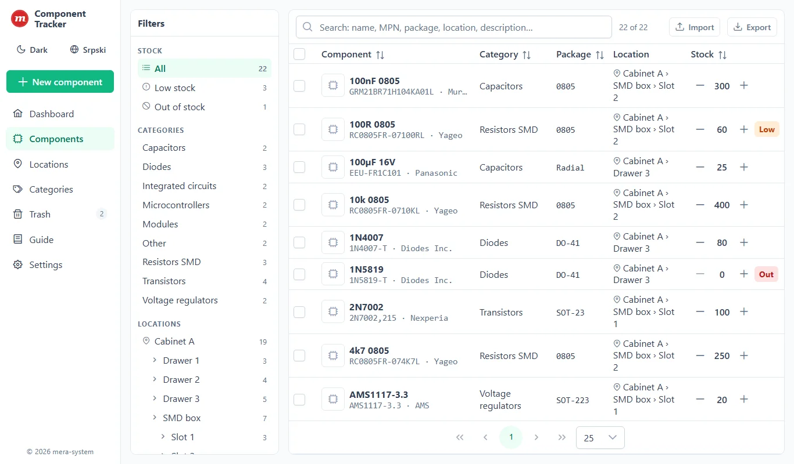
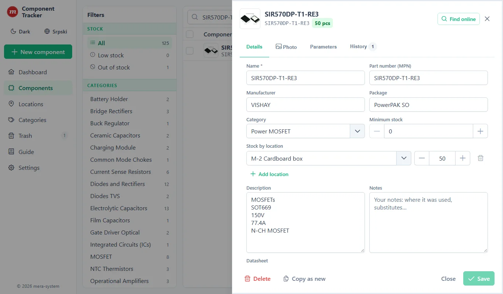
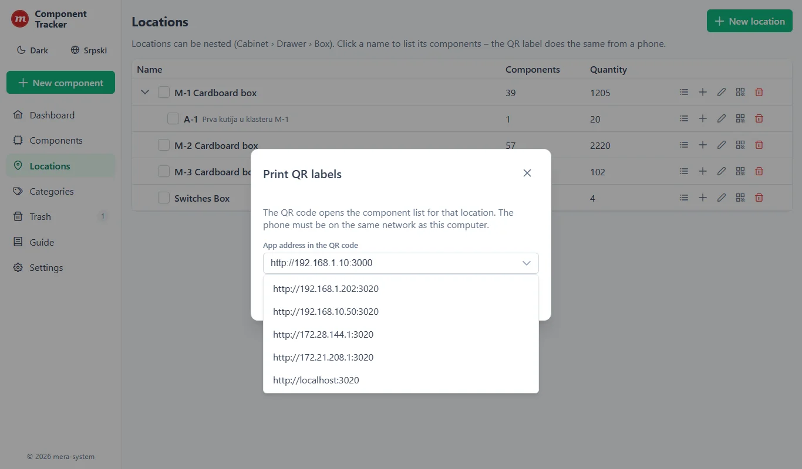

# Component Tracker

[](https://github.com/YuMERA/component-tracker/releases/latest)


[](LICENSE)
[](https://paypal.me/yumera)

Workshop inventory for electronic components – **what you have, how many and where**.

It runs on your own computer and keeps everything in a single local database: no account, no cloud.
Any browser on your local network can open it, including a phone – scan the QR label on a box and see what is inside.
English and Serbian (srpski) interface.



---

## Download

**➜ [Latest release](https://github.com/YuMERA/component-tracker/releases/latest)**

### Windows
1. Download **`ComponentTracker-setup-<version>.exe`** from the release page and run it.
   Nothing else needs to be installed.
2. If Windows shows "Windows protected your PC": **More info → Run anyway** (the program is not code-signed).
3. Open the app with the **Component Tracker** icon on the desktop.

A new version is installed the same way – run the new setup over the old one. Your data is kept,
and the database is copied to a backup before anything is replaced.

### Linux / macOS
Needs **Node.js 22.13 or newer** (`node -v`). On Ubuntu / Debian / Mint:

```bash
curl -fsSL https://deb.nodesource.com/setup_22.x | sudo -E bash -
sudo apt install -y nodejs
```

(macOS: install the LTS version from https://nodejs.org.) Then download **Source code (tar.gz)** from the release page:

```bash
tar xzf component-tracker-<version>.tar.gz
cd component-tracker-<version>
./start.sh
```

The first start takes about a minute (it installs packages and builds the app – internet required); later starts take a few seconds.
The app opens at http://localhost:3000. To stop it, press Ctrl+C in the terminal.
To upgrade, unpack the new archive and copy the `data/` folder from the old one into it.

### Using it from a phone
Phones on the same Wi-Fi can open the app at the computer's address, e.g. `http://192.168.1.10:3000`
(the exact address is shown in **Settings → About** and in the QR label dialog).

---

## Features



**Components and stock**
- Fast list with search (several words at once), filters for stock status, categories and nested locations, and sorting
- Active filters shown as chips above the table; rows per page and sorting are remembered
- Quick `− / +` stock changes right in the list (Shift = ±10)
- Side panel for viewing and editing without leaving the list; `Ctrl+S` saves
- The same component can be in several locations, each with its own quantity
- Minimum stock with "low" / "out of stock" markers and a Dashboard overview
- Full history of every stock change
- Duplicate detection by MPN, **Copy as new** for another value of the same series
- Bulk actions: move to a location, change category, delete

**Locations and QR labels**
- Nested locations (Cabinet › Drawer › Box), created on the fly by typing a path
- Printable QR labels – scanning one opens that location's components on a phone

**Online lookup (Mouser / Element14)**
- Fills in manufacturer, package, description, image and datasheet from the catalogs
- Both services are queried at once; results are merged by MPN and variants are grouped into families
- Choose the primary source, and pick the source for each field
- Needs a free API key from at least one distributor – the app works fully without it

**Import, export and safety**
- **Import from Excel / CSV** with automatic column detection and a preview before importing
- CSV and text export of the filtered or selected list
- **Trash**: deleted components, locations and categories can be restored; **Undo** right after deleting
- One-click database backup, downloadable from the browser
- Images are stored locally, datasheets on demand – works without internet

**And also**
- In-app **Guide** with screenshots
- Light / dark theme, adjustable text size, English and Serbian
- Update check: the app tells you when a new version is available



---

## Data and backup

| | Windows (installed) | Linux / macOS / from source |
|---|---|---|
| Data folder | `C:\ProgramData\ComponentTracker\` | `data/` in the app folder |

The data folder holds the database (`inventory.db`), local copies of images and datasheets,
`backups/` and `trash/` (files of deleted components until the trash is emptied).

- **Settings → Backup** creates a complete copy of the database, which can also be downloaded.
- To restore, stop the app and replace `inventory.db` with a backup file.
- Copying the whole data folder is a complete backup including images and datasheets.
- Uninstalling on Windows never deletes the data folder.

---

## Security

The app is meant for your local network. It has no login, and it listens on all network interfaces so
that phones can open it. Do not expose it directly to the internet – for remote access use a VPN
(for example WireGuard).

---

## For developers

### Run from source

```bash
git clone https://github.com/YuMERA/component-tracker.git
cd component-tracker
./start.sh            # Windows: start_app.bat
```

The start script checks Node.js, installs packages and rebuilds the frontend only when something changed.
Manual alternative: `npm install`, `npm run build`, `npm start`.

### Development mode

```bash
npm run dev
```

Starts the API server on :3000 (restarts on changes) and the Vite dev server with hot reload on http://localhost:5173.

### Configuration (optional `.env`)

From source the `.env` file sits in the project root; the installed program reads `C:\ProgramData\ComponentTracker\.env`.

| Variable | Default | Purpose |
|---|---|---|
| `APP_PORT` | `3000` | HTTP port |
| `CT_DATA_DIR` | `data/` (installed: `C:\ProgramData\ComponentTracker`) | Data folder (environment variable, not `.env`) |
| `VERSION_URL` | GitHub raw `version_info.json` | Update check source |

API keys for Mouser and Element14 are entered in **Settings → API services** and stored only in the local database.

### Windows installer

Needs Windows, Node.js 22.13+ and [Inno Setup 6](https://jrsoftware.org/isinfo.php):

```bash
npm run build:setup        # → release/ComponentTracker-setup-<version>.exe
npm run build:exe          # only release/ComponentTracker/ComponentTracker.exe, without the installer
```

The setup contains a single `ComponentTracker.exe` (Node.js and the app in one file) and runs it as the
Windows service "Component Tracker" (starts with Windows, restarts itself if it stops), adds desktop and
Start menu shortcuts and a firewall rule for private networks. The service wrapper is
[WinSW](https://github.com/winsw/winsw) 2.12 (MIT license, `installer/winsw/`).

### Guide screenshots

The in-app Guide (`client/src/guide/content.js`) uses screenshots from `client/public/guide-shots/`.
After UI changes, refresh them (Windows with Edge, or set `CHROME_PATH`):

```bash
npm run guide:screens        # both languages; or: npm run guide:screens -- sr
```

The script starts the app with made-up demo data in a temporary folder. With `--real` it uses a **copy** of
your own `data/` instead (`--data <folder>` for another one): the original is never touched, API keys in the
copy are replaced with a fake one, and online lookup is shown from results already cached in the database.
`--pick <name>` / `--lookup <name>` choose the components for the panel and lookup screenshots.

```bash
npm run guide:screens -- --real
```

### Releasing a new version

1. Raise `"version"` in `package.json` (e.g. `3.0.2` → `3.0.3`).
2. `npm run build:setup` → `release/ComponentTracker-setup-<version>.exe`.
3. Test it: a clean install, and the new setup over the installed version
   (the database is copied to `backups\inventory-before-upgrade-<date>.db` first).
4. Commit, tag `v<version>` and push both.
5. On GitHub: **Releases → Draft a new release** for that tag, write what is new (include the
   Linux / macOS steps) and drag the setup `.exe` into the assets.
6. Only **after** the release exists: in `version_info.json` set `latest_version`, point `download_url`
   to the release page and add an entry to `versions` – English `title` / `features` plus the Serbian
   translation in `"sr": { "title", "features" }`. Commit and push it: every running copy checks this
   file at start and shows "A new version is available" in its language.

### Tech stack

- **Backend:** Node.js, Express 5, SQLite (`node:sqlite`), versioned migrations
- **Frontend:** Vue 3, PrimeVue 4, Vue Router, vue-i18n, Vite
- **Lookup providers:** Mouser and Element14 (Farnell) search APIs

### Project structure

```
component-tracker/
├── server/
│   ├── index.js              Express app: API, local files, built frontend
│   ├── installed.js          Entry point of the Windows program (--open starts it and opens the browser)
│   ├── config.js             Paths, port, .env
│   ├── db/                   Connection + versioned migrations
│   ├── routes/               components, catalog (categories/locations), trash, system
│   ├── services/             Business logic: stock, import, trash, locations, files, backup, updates
│   └── providers/            Mouser / Element14 + merging, variant families, cache
├── client/
│   ├── public/guide-shots/   Guide screenshots (sr, en)
│   └── src/
│       ├── App.vue           Shell: navigation, global component panel
│       ├── views/            Dashboard, Components, Locations, Categories, Trash, Guide, Settings
│       ├── components/       Component panel, lookup and import dialogs, filters, stock editor…
│       ├── guide/            Guide text (sr, en)
│       ├── i18n/             sr.json, en.json
│       ├── store.js          Shared state
│       └── api.js            All API calls
├── data/                     Local data (git-ignored)
├── version_info.json         Release notes / update feed
├── start_app.bat / start.sh  Start from source (Windows / macOS, Linux)
├── scripts/                  Start preparation, Windows installer build, guide screenshots, icon
└── installer/                Inno Setup script, Windows service (WinSW) config, app icon
```

---

## License

This project is licensed under the Creative Commons Attribution-NonCommercial 4.0 International License
(CC BY-NC 4.0). Commercial use is **not** permitted. See the [LICENSE](LICENSE) file for details.

© mera-system · [mera-system.com](https://mera-system.com)
