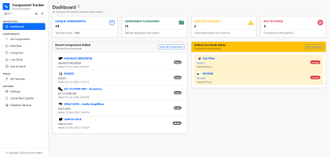
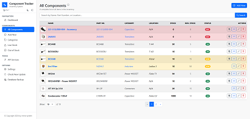
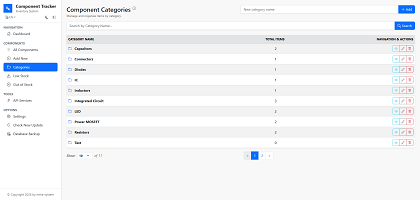
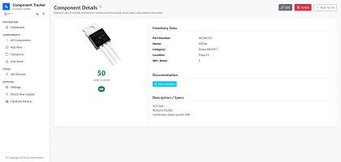
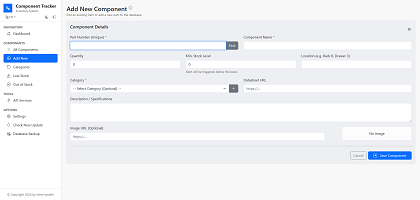
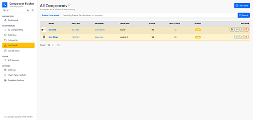
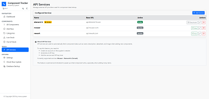
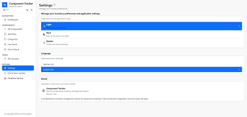
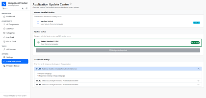
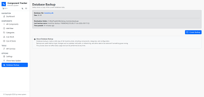

# Component Tracker

[](https://nodejs.org/en)

[](https://sqlite.org/)

[](LICENSE)
[](https://paypal.me/yumera)

---

Component Tracker is a local-first web application designed for managing
electronic components inventory in personal workshops and small labs.

The application focuses on simplicity, reliability, and full control over data.
All data is stored locally using SQLite, with no external cloud dependencies.

A simple file-based backup strategy can be applied by copying the database file,
making the system easy to maintain and restore without special tools.

---

## Features

- Full CRUD operations for components (Add / Edit / View / Delete)
- Category management with live updates
- Pagination with configurable limits
- Search and filtering
- Low-stock monitoring
- API-assisted component lookup
- Image preview support
- Datasheet links
- Internationalization (EN / SR) with live language switching
- **Dark / Light mode with live toggle**
- SQLite local database (file-based)
- No cloud services, no external database server

---

## Dark / Light Mode

The application supports both Light and Dark themes.

- Theme can be switched at any time
- Change is applied instantly (no page reload)
- User preference is preserved across sessions

This improves usability in different working environments
and during extended use.

---

## Database and Backup Strategy

Component Tracker uses a local SQLite database stored as a single file.

- No database server is required
- All data is stored locally
- The database file is excluded from version control

### Backup

Backup is intentionally simple:

- Stop the application
- Copy the database file (`inventory.db`) to a safe location

Restore is done by placing the file back in the application directory.

This approach keeps full control in the hands of the user
and avoids hidden or automated processes.

---

## API Services

The application includes a dedicated API services layer.

### Purpose

The API services layer exists to:

- Separate external vendor APIs from application logic
- Normalize different vendor responses into a common format
- Allow easy extension with additional vendors in the future

### Design

Each vendor API is implemented as an isolated service module.
Routes and views never communicate directly with external APIs.

This design:
- improves maintainability
- avoids vendor lock-in
- keeps the core application clean and predictable

Currently supported vendors include:
- Element14
- Mouser

---

## Tech Stack

- Node.js
- Express.js
- EJS (server-side rendering)
- SQLite
- Bootstrap 5
- Custom i18n system

---

## Installation

### Prerequisites

Before running the application, make sure the following are installed on your system:

- **Node.js** (v18 or newer recommended)  
  https://nodejs.org/

- **npm** (included with Node.js)


### Setup

Clone the repository and install dependencies:

```bash
    git clone https://github.com/YuMERA/component-tracker.git
    cd component-tracker
    npm install
```
This will automatically install all required dependencies defined in package.json, including:

- Express (web framework)
- EJS (template engine)
- SQLite / sqlite3 (database engine)


### Running the Application

Start the local server using npm:

```bash
    npm start
```
The application will be available at: http://localhost:3000


### Windows Quick Start (.bat)

On Windows, you can optionally create a batch file to start the server and open the browser automatically.

Create a file named start_app.bat in the project root with the following content:

```bat
@echo off
echo Starting Component Tracker...
npm start
start http://localhost:3000
```
Double-click start_app.bat to launch the application and open it in your default browser.


### First Run Notes

- The application uses a local SQLite database (inventory.db).
- If the database file does not exist, it will be created automatically on first run.
- A backups/ directory is used to store database backup files.
- The application is designed for local-first usage.

---

## Application Dependencies

All application dependencies are defined in the `package.json` file.

There are no setup or installation scripts.
Dependencies are installed using npm.

---

## Project Structure
```
component-tracker/
├── index.js                     Main application entry point
├── package.json
├── README.md
├── .gitignore
├── inventory.db                 SQLite database (local, ignored by git)
├── version_info_mock.json
├── start_app.bat                Windows quick start
│
├── apiServices/
│   ├── serviceResolver.js       API service dispatcher
│   └── vendors/
│       ├── element14.js         Element14 (Farnell) API integration
│       └── mouser.js            Mouser API integration
│
├── backups/                     Database backup storage
│
├── public/
│   ├── css/
│   │   └── custom-styles.css
│   ├── i18n/
│   │   ├── en/                  English translations
│   │   └── sr/                  Serbian translations
│   ├── images/
│   │   └── favicon.ico
│   └── js/
│       ├── confirm-modal.js
│       ├── i18n.js
│       └── table-sort.js
│
├── screenshots/                 Application screenshots
│   ├── dashboard.png
│   ├── components.png
│   ├── categories.png
│   ├── details.png
│   ├── addnew.png
│   ├── lowstock.png
│   ├── api.png
│   ├── backup.png
│   ├── settings.png
│   └── update.png
│
└── views/
    ├── layout.ejs               Global layout
    ├── dashboard.ejs
    ├── all-components.ejs
    ├── details.ejs
    ├── add-new.ejs
    ├── categories.ejs
    ├── categories-admin.ejs
    ├── backup.ejs
    ├── settings.ejs
    ├── tools-api.ejs
    └── update-check.ejs

```
---

## Internationalization (i18n)

- Custom-built i18n system
- Translation files located in public/i18n/
- Live language switching without page reload
- Easily extendable with additional languages

---

## Security and Deployment Notes

This application is intended for local use.

For remote access, it is recommended to:
- use a VPN (for example WireGuard)
- avoid exposing the application directly to the public internet

Authentication is not enforced by default.

---

## Project Status

- Stable
- Actively used
- Designed for local environments
- Not intended as a SaaS product

---

## Screenshots

### Dashboard 
[](screenshots/dashboard.png)

### Components List
[](screenshots/components.png)

### Categories Management
[](screenshots/categories.png)

### Component Details
[](screenshots/details.png)

### AddNew Component
[](screenshots/addnew.png)

### LowStock Component
[](screenshots/lowstock.png)

### Out Of Stock Component
[](screenshots/outstock.png)

### Api Services
[](screenshots/api.png)

### Settings
[](screenshots/settings.png)

### Application Update Center
[](screenshots/update.png)

### Backup Database
[](screenshots/backup.png)

---

## License

This project is licensed under the Creative Commons
Attribution-NonCommercial 4.0 International License (CC BY-NC 4.0).

Commercial use is NOT permitted.

See the LICENSE file for full details.
